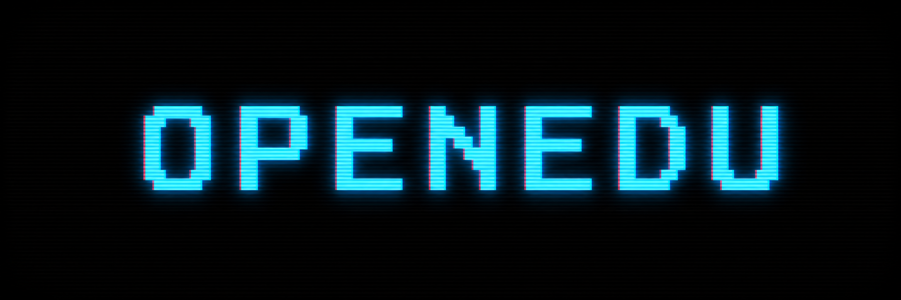
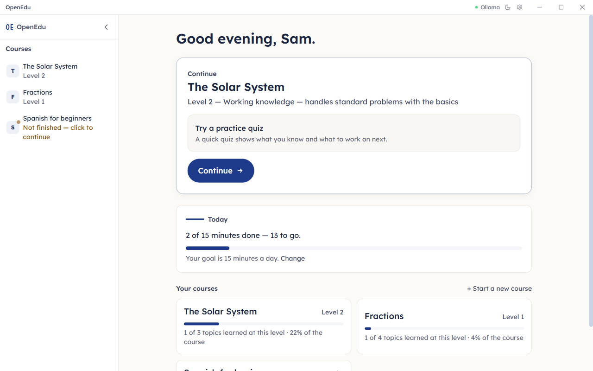
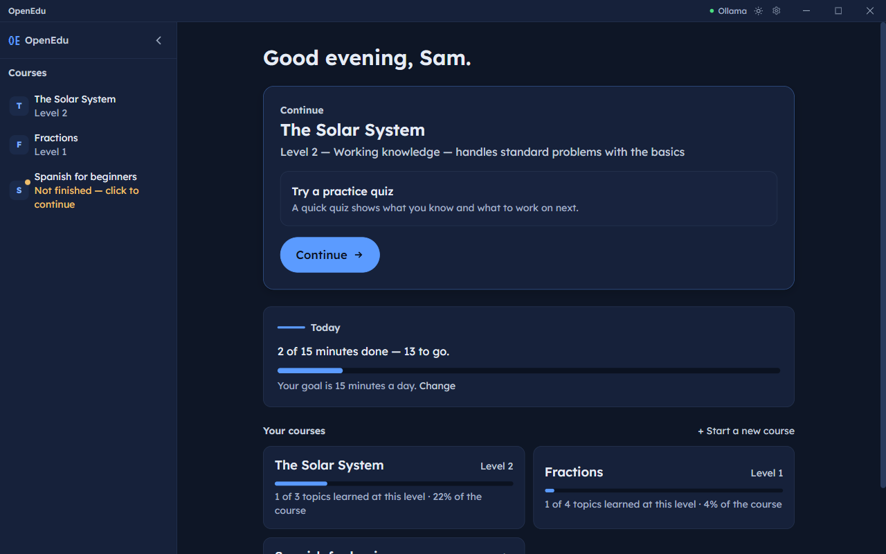
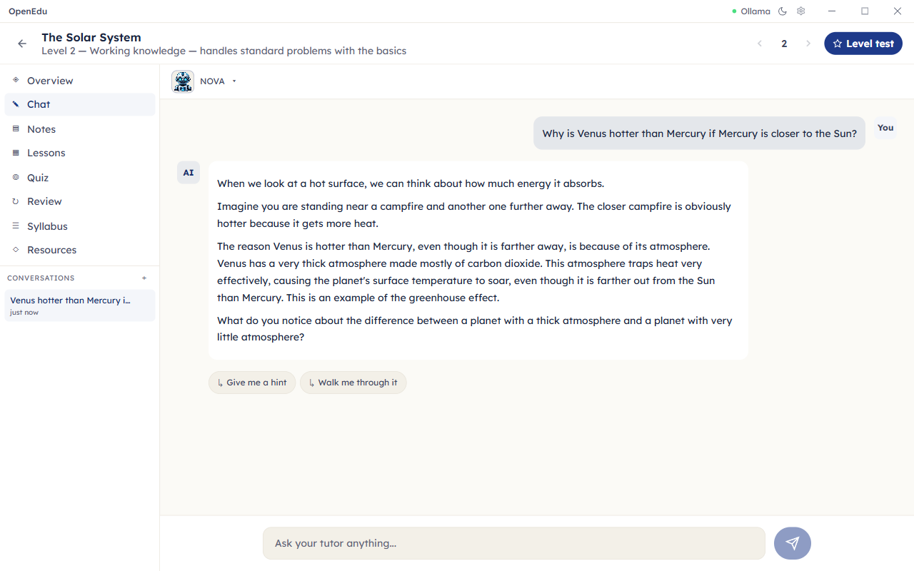
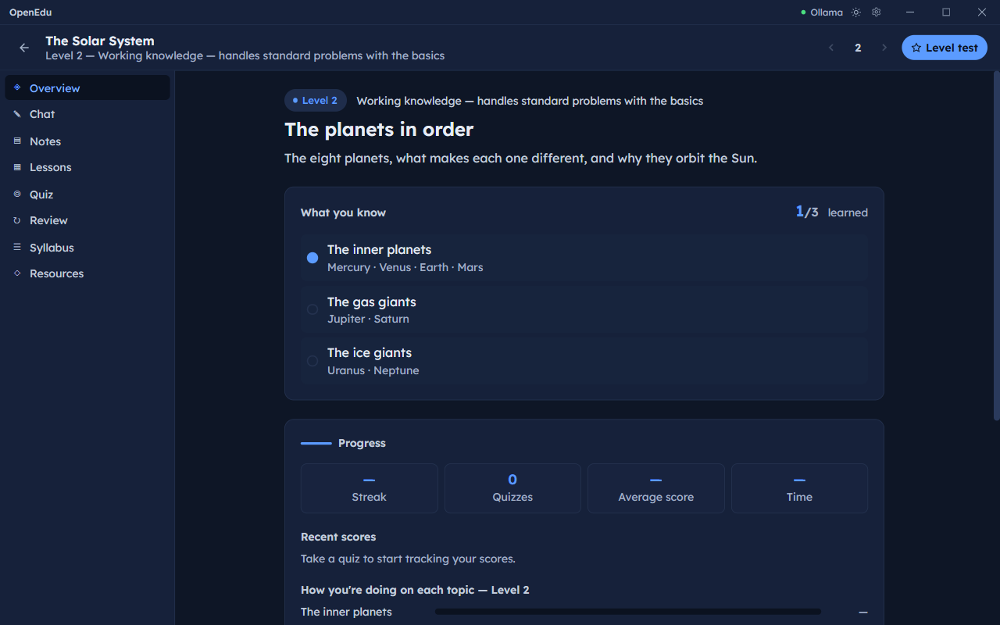
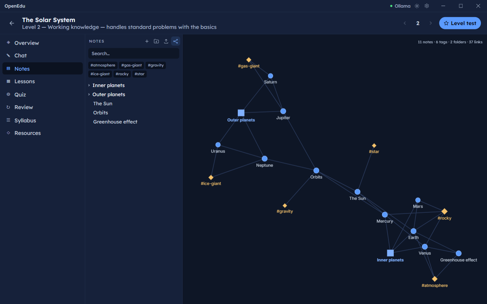
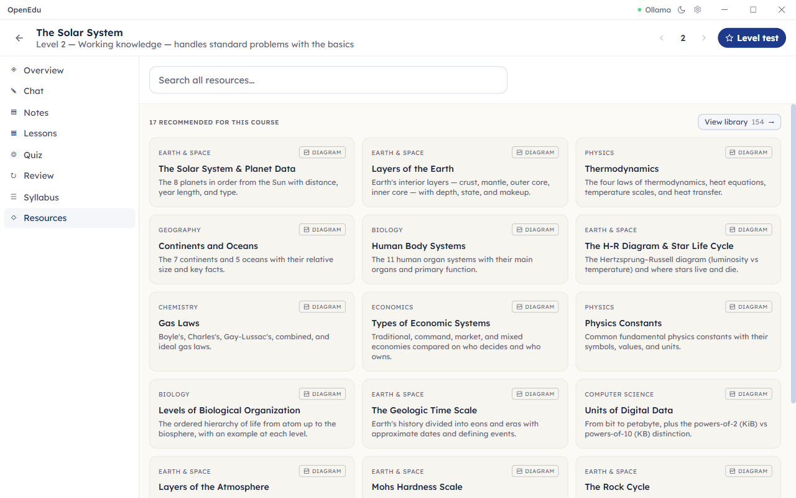
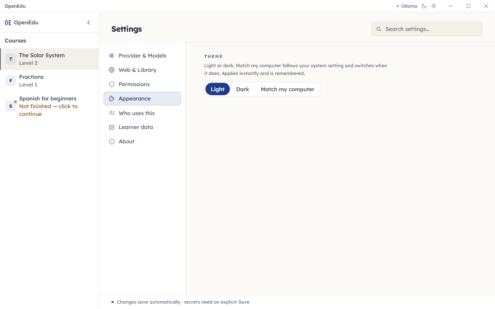

<!-- Hero: the OpenEdu wordmark. It is CRT-era art, kept until the product-name decision; see docs/assets/README.md. -->
<p align="center">
  
</p>

<p align="center">
  <strong>An AI tutor designed to stay reliable on small local models.</strong><br/>
  Bring-your-own-key, offline-first personalized learning — local on Ollama, with OpenAI / Anthropic as alternates.
</p>

<p align="center">
  <a href="LICENSE"></a>
  <a href="https://github.com/TerraByte-Dev/OpenEdu/releases/latest"></a>
  <a href="https://github.com/TerraByte-Dev/OpenEdu/actions/workflows/ci.yml"></a>
  
</p>

<p align="center">
  <a href="#features">Features</a> ·
  <a href="#screenshots">Screenshots</a> ·
  <a href="#quickstart">Quickstart</a> ·
  <a href="#architecture">Architecture</a> ·
  <a href="#development">Development</a> ·
  <a href="LICENSE">License</a>
</p>

<p align="center">
  <sub>brought to you by</sub><br/>
  <a href="https://github.com/TerraByte-Dev"></a>
</p>

---

OpenEdu generates a focused, 6-level curriculum for **any** topic, then tutors you through it — chat, quizzes,
a notebook with retrieval, and promotion tests — entirely on a local model if you want. It's built to be
**reliable on small models** — the smallest model verified end to end (generation + tutoring) is
`gemma4:e4b` (~4B effective at inference, 9.6GB on disk); the harness also runs on `qwen3.5:0.8b` (1.0GB),
but its tutoring failed our held-out eval, so we don't recommend it — and to work with **no account
and no network**: your data lives in a local SQLite database, and the only outbound calls are to the model
provider you choose, plus web search if you add a Tavily key and the update check when you click it.

OpenEdu is for one learner on their own computer. Features for families, classes and schools are not part
of it; they are in TerraTutor, a separate commercial edition by TerraByte Solutions. If an earlier version
of OpenEdu was set up for several learners, every learner and course is kept: OpenEdu asks who is
learning at launch, and each learner's PIN still guards their courses.

## Features

- **Generate a course for anything** — a research → outline → tutor-instructions → 6 syllabuses pipeline, fully schema-enforced so it holds up on small local models.
- **Bring your own key, or none** — runs free on local **Ollama**; OpenAI and Anthropic are drop-in alternates. Separate model choices for generation vs. chat vs. embeddings.
- **Offline curated Library** — a 150+ card K-12 reference set (periodic table, formulas, definitions, maps…) bundled in the app; the tutor can cite it mid-lesson with zero network.
- **Notebook with retrieval** — an Obsidian-style vault with a live-preview editor, `[[wiki-links]]`, note-free `#tags`, and a vault graph; documents are embedded locally so the tutor can search and cite your notes.
- **Quizzes & promotion tests** — per-level practice plus a code-assembled mastery exam.
- **Tutor permissions** — a per-tool allow / ask / deny policy (Standard · Cautious · Trusting presets) governing what the tutor may do on its own.
- **Light and dark** — a calm "Notebook" look (warm paper, navy ink, one blue accent) in light, dark, or matching your computer — all CSS-variable driven.

## Screenshots

> Captured live in `npm run tauri dev` at 1280 × 800 with demo data. See [`docs/assets/screenshots/README.md`](docs/assets/screenshots/README.md) for the shot list + capture settings.

<table>
  <tr>
    <td width="50%" valign="top">
      <br/>
      <sub><b>Home, light</b> — one Continue button to your latest course and its next step, a daily goal, and your courses.</sub>
    </td>
    <td width="50%" valign="top">
      <br/>
      <sub><b>Home, dark</b> — the same screen in the navy dark mode. Flip with the sun/moon button in the title bar.</sub>
    </td>
  </tr>
  <tr>
    <td width="50%" valign="top">
      <br/>
      <sub><b>Tutor chat</b> — a reply from <code>gemma4:e2b</code> on local Ollama, with hint and walk-through chips.</sub>
    </td>
    <td width="50%" valign="top">
      <br/>
      <sub><b>Course view</b> — the current level's topics, what you know so far, and your progress.</sub>
    </td>
  </tr>
  <tr>
    <td width="50%" valign="top">
      <br/>
      <sub><b>Notebook graph</b> — your notes (circles), folders (squares) and <code>#tags</code> (diamonds), joined by <code>[[wiki-link]]</code> edges.</sub>
    </td>
    <td width="50%" valign="top">
      <br/>
      <sub><b>Offline Library</b> — a curated 154-card K-12 reference set the tutor can cite, fully offline.</sub>
    </td>
  </tr>
  <tr>
    <td colspan="2" align="center" valign="top">
      <br/>
      <sub><b>Appearance</b> — Light, Dark, or Match my computer. That's the whole choice.</sub>
    </td>
  </tr>
</table>

## Quickstart

**Prerequisites**

- [Node.js](https://nodejs.org/) 20.19+ or 22.12+
- [Rust](https://www.rust-lang.org/tools/install) + the [Tauri v2 system dependencies](https://v2.tauri.app/start/prerequisites/) for your OS
- (For the free local path) [Ollama](https://ollama.com/) with a model pulled, e.g. `ollama run gemma4:e4b`

**Run**

```bash
git clone https://github.com/TerraByte-Dev/OpenEdu.git
cd OpenEdu
npm install
npm run tauri dev      # launches the desktop app
```

On first run, open **Settings** (the gear) to pick your provider/model. With Ollama running locally you're
ready to generate your first course — no key required.

> Prefer a prebuilt installer? Grab the latest signed build from [**Releases**](https://github.com/TerraByte-Dev/OpenEdu/releases/latest) — update from **Settings → About → Check for updates** (the app never checks on its own).

## Development

```bash
npm run tauri dev      # dev app with HMR
npm test               # unit tests (vitest)
npm run build          # typecheck (tsc) + frontend bundle (vite)
```

CI runs typecheck + tests + build on every pull request (`.github/workflows/ci.yml`).

## Architecture

The data lives entirely in SQLite (`%APPDATA%/com.terrabytesolutions.openedu/openedu.db` on Windows) — no
per-course files. A few orientation points:

- `src/lib/curriculum.ts` — the generation agent harness (`runGenerationPipeline`).
- `src/lib/llm.ts` — provider abstraction, streaming, schema-enforced structured output, model-tier detection.
- `src/lib/db.ts` — SQLite CRUD; `src-tauri/` — Rust backend + migrations.
- `src/views/settings/` — the tabbed Settings view: a left rail built from a section registry ([its README](src/views/settings/README.md)).

## Backing up and restoring learner data

Your courses, chats, notes, quizzes and progress live in that one `openedu.db` file. A power cut
can damage it, so keep a copy somewhere else.

**Back up:** open **Settings → Learner data → Back up all learner data** and save the file, for example to
a USB stick. The default name is `openedu-backup-YYYY-MM-DD-HHMM.db`. You can keep using the app while it saves.

**Restore:** OpenEdu checks the file each time it starts and shows a warning if it finds damage. To restore:

1. Close OpenEdu.
2. Open the folder `%APPDATA%\com.terrabytesolutions.openedu\` (Windows). Settings → Learner data shows
   the exact path on any system.
3. Move `openedu.db` into a new folder called `old`, along with `openedu.db-wal` and `openedu.db-shm` if
   they are there. Keep them.
4. Copy your backup into the first folder and rename it. If file names there end in `.db`, type
   `openedu.db`. If Windows hides file endings, type just `openedu`; typing `openedu.db` would make
   `openedu.db.db`, and OpenEdu would start with no data.
5. Start OpenEdu.

Anything done after the backup was made is not in it.

Deeper notes: [`docs/ARCHITECTURE.md`](docs/ARCHITECTURE.md) (how it's built) and
[`CONTRIBUTING.md`](CONTRIBUTING.md) (dev workflow).

## License

[MIT](LICENSE) © TerraByte Solutions LLC.

The bundled dictionary (`public/dictionary/`) is adapted from [Open English WordNet](https://github.com/globalwordnet/english-wordnet)
2025, by the Open English WordNet team (reformatted and trimmed; see `meta.json`), under [CC BY 4.0](public/dictionary/LICENSE.md). It is derived from
WordNet 3.1, © Princeton University, under the [WordNet licence](public/dictionary/WNDB_License.txt).

<p align="center">
  <a href="https://github.com/TerraByte-Dev"></a><br/>
  <sub>An open-source project by <strong>TerraByte Solutions LLC</strong></sub>
</p>
